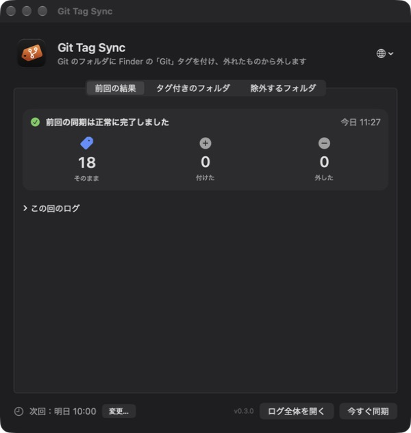

# Git Tag Sync

[English](README.md)

Git のリポジトリになっているフォルダに、Finder の「Git」タグを自動で付けておく macOS 用のツールです。Git の管理から外れたフォルダからは、タグを外します。毎日決まった時刻に launchd から実行し、結果はアプリの画面で見られます。

Finder で「Git」タグを選ぶと、Mac の中のリポジトリが一覧できます。



## しくみ

- ホームフォルダ全体から、`.git`（フォルダでもファイルでもよい）があるフォルダを探し、「Git」タグを付けます。
- 「Git」タグが付いているのに `.git` がなくなったフォルダからは、タグを外します。
- 除外先（`excludes.txt`）の中と、名前が `.` で始まるフォルダの中は、探さず、タグを付けも外しもしません。`.` で始まるフォルダには、ツールが内部で作るリポジトリ（エディタやAIツールの履歴、`~/.nvm` など）が多いためです。
- タグの操作には [tag](https://github.com/jdberry/tag) コマンドを使います。

## 必要なもの

- macOS 14 以降
- Command Line Tools（`swiftc`。`xcode-select --install` で入る）
- tag コマンド（`brew install tag`）
- アイコンを直すときだけ Xcode

## 入れ方

```bash
git clone https://github.com/zerollpaper/git-tag-sync.git
cd git-tag-sync
zsh install.sh            # 初回は毎日 10:00 に同期する
zsh install.sh --hour 9 --minute 30   # 毎日その時刻に同期する
```

`install.sh` は次のことをします。

1. アプリ `~/Applications/Git Tag Sync.app` を作る。
2. launchd のジョブ `local.git-tag-sync`（`~/Library/LaunchAgents/local.git-tag-sync.plist`）を作り直す。
3. `excludes.txt` がなければ、`excludes.example.txt` を写して作る（最初は `~/Library` だけを除外）。

入れたあと、システム設定 > プライバシーとセキュリティ > **フルディスクアクセス** の「＋」で `~/Applications/Git Tag Sync.app` を追加してください。これがないと、書類・デスクトップ・ダウンロードなどを探せません。

スクリプトはクローンした場所から実行されるので、フォルダを動かしたら `install.sh` を実行し直してください。

### なぜアプリを挟むか

launchd から `zsh` を直接起動すると、フルディスクアクセスを付ける相手がなく、書類などのフォルダを読めません。Git Tag Sync.app から起動すると、許可がこのアプリに与えられ、その子プロセス（`zsh`・`find`）にも効きます。

### 署名

macOS はフルディスクアクセスの許可を「アプリの署名」に対して記録します。

- **キーチェーンにコード署名用の証明書があれば**（既定の名前は「Local Code Signing」。環境変数 `GIT_TAG_SYNC_SIGN_ID` で変えられる）、それで署名します。アプリは「識別子＋証明書」で見分けられるので、入れ直しても許可は外れません。
- **なければアドホック署名**になります。アプリは中身のハッシュで見分けられるので、入れ直すたびに、フルディスクアクセスを「−」で消して「＋」で追加し直す必要があります（オンのまま残っている項目は古い署名に対するもので、切り替えても効きません）。

自己署名の証明書は、次のコマンドで作れます（10年有効）。Homebrew の OpenSSL 3 以降では、そのままの形式だとキーチェーンに取り込めないので、`-certpbe`・`-keypbe`・`-macalg` で古い形式にしています。

```bash
D=$(mktemp -d) && cd "$D"
printf '[req]\ndistinguished_name=dn\nx509_extensions=ext\nprompt=no\n[dn]\nCN=Local Code Signing\n[ext]\nbasicConstraints=critical,CA:false\nkeyUsage=critical,digitalSignature\nextendedKeyUsage=critical,codeSigning\n' > cert.cnf
openssl req -x509 -newkey rsa:2048 -nodes -days 3650 -config cert.cnf -keyout key.pem -out cert.pem
PW=$(openssl rand -hex 16)
openssl pkcs12 -export -certpbe PBE-SHA1-3DES -keypbe PBE-SHA1-3DES -macalg sha1 -inkey key.pem -in cert.pem -name "Local Code Signing" -out id.p12 -passout "pass:$PW"
security import id.p12 -k ~/Library/Keychains/login.keychain-db -P "$PW" -T /usr/bin/codesign
cd / && rm -rf "$D"
```

`security find-identity -p codesigning` に「Local Code Signing」が `CSSMERR_TP_NOT_TRUSTED` 付きで出ますが、署名にもフルディスクアクセスにも問題ありません。

## 使い方

アプリを開くと、3つのタブがあります。

- **前回の結果**：状態（正常／警告あり／完了せず）と日時、件数（そのまま・付けた・外した）、変化があったフォルダ、警告、その回のログ。読めない場所があったときは、フルディスクアクセスの案内が出ます。
- **タグ付きのフォルダ**：今「Git」タグが付いているフォルダの一覧（Spotlight で探す）。Finder で表示したり、除外に追加したりできます。
- **除外するフォルダ**：探す範囲と除外先の一覧。「フォルダを追加…」と「−」で編集できます。**除外に追加すると、そのフォルダと中の「Git」タグを外します**。除外から外すと、次の同期で中のリポジトリにタグが付きます。

下の段には、次回の実行時刻、「変更…」（自動で同期する時刻を変える）、「ログ全体を開く」（コンソールで開く）、「今すぐ同期」があります。

### 自動で同期する時刻

次回の実行時刻の横の「変更…」で選べます。

- **毎日**：決まった時刻に
- **一定の間隔**：起点の時刻から、1・2・3・4・6・8・12時間ごとに
- **しない**：「今すぐ同期」を押したときだけ

「ログインしたときにも同期する」も選べます。スリープ中に時刻を過ぎたときは、起きたときに同期します。そのため「N時間ごと」は、秒の間隔（`StartInterval`）ではなく、時刻を並べた指定（`StartCalendarInterval`）で launchd に登録します。設定は launchd の plist に保存され、`install.sh` を実行し直しても引き継がれます（`--hour`・`--minute` を指定したときは「毎日その時刻」になります）。

### 除外先（`excludes.txt`）

1行に1フォルダ（`~` で始めてよい）で書きます。空行と `#` で始まる行は読み飛ばします。手で編集してもかまいません（手で足したときは中のタグは外れないので、要るなら `git-tag-sync.sh --untag フォルダ` を実行します）。

`~/Library` はフォルダの数がとても多く、探索時間の大半を占めます。ここにリポジトリを置いていなければ、除外したままにしておくと速くなります。

### ターミナルから

```bash
zsh git-tag-sync.sh --dry-run        # 試す（タグを変えない）
zsh git-tag-sync.sh                  # 同期する
zsh git-tag-sync.sh --quiet          # 変化のない KEEP の行を出さない
zsh git-tag-sync.sh --untag ~/foo    # 同期はせず、~/foo とその中の「Git」タグを外す
launchctl kickstart gui/$(id -u)/local.git-tag-sync   # 登録したジョブを今すぐ動かす
```

ログは `~/Library/Logs/git-tag-sync.log` に追記されます。1回分は「=== 開始」の行、変化（ADD・REMOVE）と警告、`SUMMARY` の行、「=== 終了（終了コード）」の行です。前回の結果は `~/Library/Application Support/Git Tag Sync/last-run.json` に保存されます。

### 言語

アプリの画面とログ、スクリプトのメッセージは、英語と日本語に対応しています。既定では macOS の言語設定に合わせます。このアプリだけ言語を変えたいときは、ウインドウ右上の地球儀のボタンか、メニューバーの「言語」で選びます（「システムに合わせる」「English」「日本語」）。画面はその場で切り替わり、自動の同期のログもその言語で書かれます。ターミナルから実行したスクリプトは `LANG`（空なら macOS の言語設定）に従います。

## 取り除き方

```bash
zsh uninstall.sh
```

launchd のジョブ、アプリ、前回の結果を消します。このフォルダ、ログ、付いている「Git」タグは残します。タグも外したいときは、先に `zsh git-tag-sync.sh --untag ~` を実行してください。フルディスクアクセスの一覧に残った項目は「−」で消してください。

## ファイル

| ファイル | 役割 |
|---|---|
| `git-tag-sync.sh` | 同期の本体（zsh） |
| `excludes.example.txt` | 除外先の例。`install.sh` が `excludes.txt` に写す |
| `Sources/main.swift` | アプリ。`--run` で起動されると画面を出さずにスクリプトを実行して結果を保存し、引数なしで開くと結果の画面を出す |
| `install.sh` / `uninstall.sh` | 入れる・取り除く |
| `VERSION` / `CHANGELOG.md` | 版（`git-tag-sync.sh --version` とアプリの画面に出る）と変更点 |
| `GitTagSync.icon` | アイコン（Icon Composer の形式）。ダーク・クリア・色合い調整の各表示に対応 |
| `Resources/` | 変換済みのアイコン（`GitTagSync.icon` を直したら `tools/build-icon.sh` で作り直す。Xcode が要る）と、画面の文の訳（`*.lproj/Localizable.strings`。正本は英語なので `en.lproj` は空）。訳の漏れは `tools/check-strings.py` で調べる |

## ライセンス

MIT
