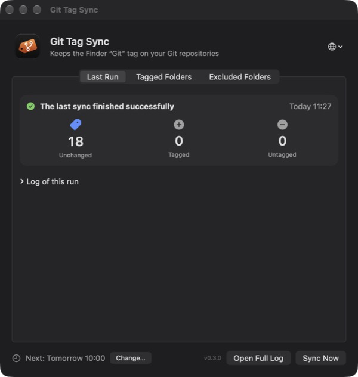

# Git Tag Sync

[日本語](README.ja.md)

A small macOS app that keeps a Finder tag named **Git** on every folder that is a Git repository, and removes it from folders that no longer are. It syncs on a schedule from launchd and shows the result in a window. It has no dependencies beyond macOS.

Select the "Git" tag in the Finder sidebar to see every repository on your Mac.



## How it works

- Searches your home folder for folders that contain `.git` (a directory or a file) and adds the "Git" tag to them.
- Removes the tag from tagged folders that no longer contain `.git`.
- Never searches, tags or untags inside the excluded folders or inside folders whose names start with `.` (tools keep many internal repositories there, such as editor or AI tool history and `~/.nvm`).
- Everything runs inside the app: it walks the folders with the same OS mechanism as `find` (`fts`), reads and writes Finder tags through the macOS API, and finds tagged folders with Spotlight (`mdfind`). A sync takes about half a second without `~/Library`.

## Requirements

- macOS 14 or later
- Command Line Tools (`swiftc`; `xcode-select --install`)
- Xcode, only if you edit the icon

## Install

```bash
git clone https://github.com/zerollpaper/git-tag-sync.git
cd git-tag-sync
zsh install.sh                       # sync every day at 10:00 (first install)
zsh install.sh --hour 9 --minute 30  # or every day at the time you choose
```

`install.sh`:

1. builds `~/Applications/Git Tag Sync.app`,
2. (re)creates the launchd job `local.git-tag-sync` (`~/Library/LaunchAgents/local.git-tag-sync.plist`),
3. moves `excludes.txt` from this folder to the app's data folder if you used version 0.3.0 or earlier.

Then open System Settings > Privacy & Security > **Full Disk Access** and add `~/Applications/Git Tag Sync.app` with the "+" button. Without it, folders such as Documents, Desktop and Downloads cannot be searched.

### Why an app

A shell script started directly by launchd has nothing to grant Full Disk Access to, so it cannot read protected folders. The scheduled job starts Git Tag Sync.app itself (with `--run`), and the app reads the folders with the permission you gave it.

### Code signing

macOS records Full Disk Access against the app's code signature.

- **If your keychain has a code signing certificate** (named "Local Code Signing" by default; set `GIT_TAG_SYNC_SIGN_ID` to use another), the app is signed with it. macOS then identifies the app by its identifier and certificate, so the permission survives reinstalls.
- **Otherwise the app is signed ad hoc.** macOS then identifies it by a hash of its contents, so after every reinstall you have to remove the app from the Full Disk Access list with "−" and add it again with "+" (an entry that is still switched on belongs to the old signature).

To create a self-signed certificate (valid for 10 years):

```bash
D=$(mktemp -d) && cd "$D"
printf '[req]\ndistinguished_name=dn\nx509_extensions=ext\nprompt=no\n[dn]\nCN=Local Code Signing\n[ext]\nbasicConstraints=critical,CA:false\nkeyUsage=critical,digitalSignature\nextendedKeyUsage=critical,codeSigning\n' > cert.cnf
openssl req -x509 -newkey rsa:2048 -nodes -days 3650 -config cert.cnf -keyout key.pem -out cert.pem
PW=$(openssl rand -hex 16)
openssl pkcs12 -export -certpbe PBE-SHA1-3DES -keypbe PBE-SHA1-3DES -macalg sha1 -inkey key.pem -in cert.pem -name "Local Code Signing" -out id.p12 -passout "pass:$PW"
security import id.p12 -k ~/Library/Keychains/login.keychain-db -P "$PW" -T /usr/bin/codesign
cd / && rm -rf "$D"
```

The legacy `-certpbe`/`-keypbe`/`-macalg` options are needed because the keychain cannot import the default format of OpenSSL 3 and later. `security find-identity -p codesigning` lists the certificate with `CSSMERR_TP_NOT_TRUSTED`; that does not matter for signing or for Full Disk Access.

## Usage

The app has three tabs:

- **Last Run**: status, time, counts (unchanged, tagged, untagged), the folders that changed, warnings and the log of that run. If some folders could not be read, it points you to Full Disk Access.
- **Tagged Folders**: every folder that currently has the "Git" tag (found with Spotlight). Show it in Finder or exclude it.
- **Excluded Folders**: the search scope and the excluded folders. Add folders with "Add Folder…" and remove them with "−". **Excluding a folder removes the "Git" tag from it and from everything inside it.** After you stop excluding it, the repositories inside are tagged at the next sync.

At the bottom: the next scheduled run, "Change…" (change the schedule), "Open Full Log" (open the log in Console) and "Sync Now".

### Schedule

Click "Change…" next to the next run to choose when to sync automatically:

- **Every day** at a time,
- **Every few hours**: every 1, 2, 3, 4, 6, 8 or 12 hours from a start time,
- **Never**: only when you click "Sync Now".

You can also turn on **Also sync at login**. If the Mac was asleep at a scheduled time, the sync runs when it wakes up. "Every N hours" is registered as a list of times (`StartCalendarInterval`) for that reason. The setting lives in the launchd plist; running `install.sh` again keeps it unless you pass `--hour`/`--minute`.

### Excluded folders

They are saved in `~/Library/Application Support/Git Tag Sync/excludes.txt` (created from `excludes.example.txt` the first time). One folder per line (`~` is allowed); blank lines and lines starting with `#` are ignored. You can also edit the file by hand; tags inside a folder you add by hand are not removed, so add it in the app if you want that.

`~/Library` contains a very large number of folders and takes most of the search time. Keep it excluded unless you keep repositories there.

### Log

Each sync is appended to `~/Library/Logs/git-tag-sync.log`: a start line, the folders that were tagged (`ADD`) or untagged (`REMOVE`), warnings, a `SUMMARY` line and a finish line with the exit code. The last result is also saved to `~/Library/Application Support/Git Tag Sync/last-run.json`, which the app shows.

### Language

The app and its log are in English or Japanese. By default they follow your macOS language. To choose one for this app only, use the globe button at the top right of the window or the Language menu ("System Setting", "English" or "日本語"); the window switches at once, and the scheduled sync writes its log in the same language. `install.sh` and `uninstall.sh` follow `LANG` (or your macOS language if `LANG` is not set).

## Uninstall

```bash
zsh uninstall.sh                 # keep the "Git" tags
zsh uninstall.sh --remove-tags   # remove every "Git" tag in your home folder first
```

This removes the launchd job, the app and the saved result. It keeps the excluded folders list and the log. Remove the app from the Full Disk Access list with "−".

## Files

| File | Purpose |
|---|---|
| `Sources/main.swift` | The app. With `--run` it syncs without a window and saves the result (the scheduled job uses this); with `--untag <folder>` it removes the tag from that folder and everything inside (`uninstall.sh --remove-tags` uses this); opened normally it shows the window |
| `excludes.example.txt` | The default excluded folders, bundled into the app |
| `install.sh` / `uninstall.sh` | Install and uninstall |
| `VERSION` / `CHANGELOG.md` | The version (shown in the app) and the changes |
| `GitTagSync.icon` | The icon (Icon Composer format), with dark, clear and tinted variants |
| `Resources/` | The compiled icon (run `tools/build-icon.sh`, which needs Xcode, after editing `GitTagSync.icon`) and the translations (`*.lproj/Localizable.strings`; English is the source, so `en.lproj` is empty). Run `tools/check-strings.py` to find missing translations |

## License

MIT
